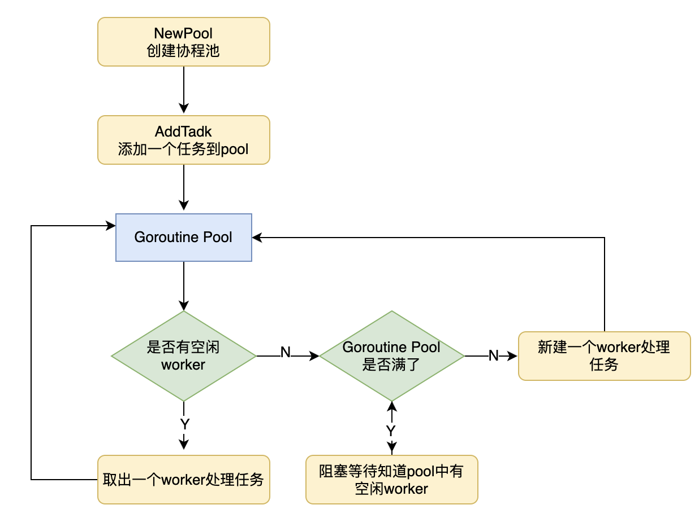

## 协程池
协程池简单理解就是有一个池子一样的东西，里面装这个固定数量的goroutine，
当有一个任务到来的时候，会将这个任务交给池子里的一个空闲的goroutine去处理，如果池子里没有空闲的goroutine了，任务就会阻塞等待。
所以协程池有三个角色Worker，Task，Pool。

## 具体思路
1. 慢增长的启动 多个后台 goroutine 来进行监听 Job Channel是否有任务
2. 如果当前任务加入进来，并 Worker Pools 没有满的话 那么则进行处理
3. 否则的话 进行阻塞

